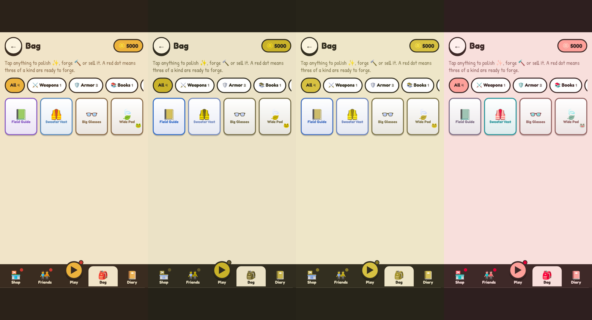
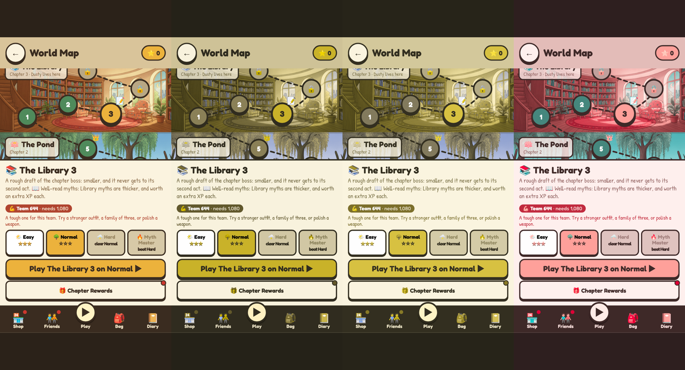

# Colour-blind check, build 57

I simulated the home screen, a battle, the Bag, a friend's card, the World Map and the Skill Tree for the three common kinds of colour blindness (Machado et al. 2009, full strength): protan, deutan and tritan. About 1 in 12 boys has a red-green type.

Each image below shows, left to right: normal, protan, deutan, tritan.

## What needed fixing

| Where | Problem | Fix |
|---|---|---|
| The Power check on Play and the World Map | Green (ready), amber (close) and red (too weak) all turn the same olive brown for red-green colour blindness | It now also starts with ✔, ≈ or ⚠ |
| Bag tiles | Rare (blue) and Epic (purple) borders look identical for protan and deutan | Every tile shows its rarity as 1 to 4 diamonds (◆) in the corner |

## Already fine

These don't rely on colour alone:
- **Elements:** their emoji are drawn on myths, on chips, and in reactions.
- **Difficulty buttons:** named and starred.
- **Map pins:** they show numbers, stars, padlocks, crowns and flames.
- **Skill Tree:** it says Chosen, Maxed or Done.
- **Friend tiers and families:** labelled in words.
- **Patience and HP bars:** they show numbers, or their length is the signal.
- **Red notification dots:** read by their position and shape.
